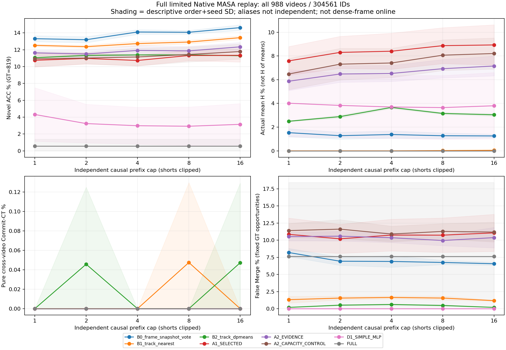
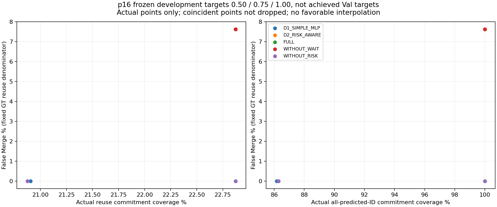

# TrackOCD M0–M10 final research handoff

## Outcome and explicit scope amendment

Complete **authorized research negative result**, not strong end-to-end
TrackOCD success. The original M1 strong-quality/provenance condition remains
BLOCKED_FRONTEND_QUALITY. The user's later Train-first amendment (SHA256
`cc874517b5366c019b625ce3d6fcf0a33333c359cfb1dd8d03039d2cde290e99`) explicitly authorized limited Native
MASA and credible negative completion; it did not qualify M1. The original
FINAL_GOAL.json and frozen amendment remain historical preregistration records,
not live app-state controls. No missing work is hidden as a successful method.

33 actual fits / 33 selected and 99 retained checkpoints, 2220 controlled
cases; 840 unique all-ID sealed Val executions / 2040 explicitly aliased
logical references. All four video orders and all five prefixes retained.
No new training, inference, GT join or tuning for this report-only handoff.

## Every original M0–M10 requirement disposition

| Stage | Execution / disposition | Scientific gate | Finding |
|---|---|---|---|
| M0 | PASS | PASS | Exact 81/81 NAS v2 blobs recovered, not main Phase88/89/90; historical branches/stashes/assets preserved. 255 old COVTrack shards remain partial/unvalidated, not restored complete. |
| M1 | ADDRESSED_BY_EXPLICIT_AMENDMENT | BLOCKED | No strong clean frontend qualified. User authorized frozen limited Native MASA replay; checkpoint training-stage binding incomplete; no Novel-exclusion guarantee or dense-frame claim. |
| M2 | PASS | PASS | Shared frozen DINO 768-D, prefix 1/2/4/8/16 clipped for shorts, all 988 videos/304561 IDs, 1294110 observations, no future/GT/semantic input. CPU/CUDA exact replay proofs; no approximate search. |
| M3 | PASS | PASS | Full 4413/819 GT and order-specific 527/529/547/531 CT denominators; unknown/missing retained; known IDs never remapped, one global posthoc Hungarian, pure predicted memory CT with no GT repair. |
| M4 | PASS_WITH_CONDITIONAL_INCOMPARABLE | INCOMPARABLE_PHE_ONLY | Raw frame vote / nearest / DP-Means same inputs and all prefixes/orders; PHE lacks compatible 78-class/common-feature supervision, not invented as reproduced. |
| M5 | PASS | FAIL | 9 real adapter and 6 temporal/static fits; partial Known/H gains, not stable held-out Novel geometry or independent temporal advantage over capacity control. |
| M6 | PASS | PASS | Train intersect inherited Known only; distinct category/video folds; genuine Val Novel and other Train roles excluded; predicted-action memory rollouts. |
| M7 | PASS | FAIL | 18 actual 708-parameter matched D1/D2 fits with cost/credit differences, bounded costly WAIT and no oracle memory. Pure CT zero in learned controlled and Val policy matrices. |
| M8 | PASS | FAIL | Three independent training seeds, controlled held-out four-order/five-prefix matrices; old R0/R1 preserved, no rescue R2 or held-out redesign. Sparse four pseudo classes / 16 queries disclosed. |
| M9 | PASS_UNDER_AMENDED_LIMITED_SCOPE | FAIL | 840 sealed unique all-ID executions / 2040 explicit aliases and metrics; primary full GT plus matched-only diagnostics, per-order/seed std, prefix and risk plots. Existing Native physical scores reused, no new tracking gain. |
| M10 | PASS | FAIL | All registered ablations, exact-capacity static/MLP, cross-video retrieval/CT, 780 fixed pairs, both coverage gaps and paired fix/new errors. 84 primary p16 conditional 500-video bootstraps; not independent causal intervals. |

M11 NOT_AUTHORIZED: independent representation/temporal/persistent gates
FAIL. PHE INCOMPARABLE, not silently omitted or reported as reproduced.
See [actual Core report](CORE_TRAINING_FINAL_REPORT.md), [architecture](METHOD_ARCHITECTURE.md),
[training protocol](TRAINING_PROTOCOL.md), [leakage audit](DATA_PROTOCOL_AND_LEAKAGE_AUDIT.md)
and [ten scientific answers](SCIENTIFIC_CONCLUSION.md).

## Primary full-GT predicted-track p16 results

Percentages: mean ± descriptive population SD across the frozen seed/order
cases (raw baselines one control seed). Not a confidence interval or 2040
independent runs; actual mean H is **not H(mean Old, mean New)**.
PER_SEED_FOUR_ORDER_RESULTS.csv gives each seed's actual four-order mean and
four-order SD. BASELINE_COMPARISON.csv gives the mean of those seed means,
between-seed SD and descriptive combined order+seed SD. Individual order /
seed / prefix / full scope values remain in PER_VIDEO_ORDER_RESULTS.csv.

| Method | Old % | New % | actual mean H % | pure CT % |
|---|---:|---:|---:|---:|
| A1_SELECTED | 7.8103 ± 2.3772 | 11.3350 ± 0.7989 | 8.9303 ± 1.6986 | 0.0000 ± 0.0000 |
| A2_CAPACITY_CONTROL | 6.5809 ± 1.8842 | 11.7827 ± 0.8896 | 8.2052 ± 1.3111 | 0.0000 ± 0.0000 |
| A2_EVIDENCE | 5.0816 ± 0.8416 | 12.3423 ± 0.5286 | 7.1512 ± 0.8295 | 0.0000 ± 0.0000 |
| B0_frame_snapshot_vote | 0.6571 ± 0.0833 | 14.6215 ± 0.3385 | 1.2567 ± 0.1509 | 0.0000 ± 0.0000 |
| B1_track_nearest | 0.0227 ± 0.0160 | 13.4310 ± 0.2284 | 0.0452 ± 0.0319 | 0.0000 ± 0.0000 |
| B2_track_dpmeans | 1.7562 ± 0.0793 | 11.2943 ± 0.0611 | 3.0388 ± 0.1164 | 0.0473 ± 0.0819 |
| D1_SIMPLE_MLP | 11.9023 ± 6.1015 | 3.1441 ± 2.4638 | 3.8004 ± 2.8016 | 0.0000 ± 0.0000 |
| D2_RISK_AWARE | 14.3818 ± 10.2050 | 0.5698 ± 0.8058 | 0.0000 ± 0.0000 | 0.0000 ± 0.0000 |
| FULL | 14.5102 ± 10.2789 | 0.5698 ± 0.8058 | 0.0000 ± 0.0000 | 0.0000 ± 0.0000 |
| RESET_PER_VIDEO | 14.5102 ± 10.2789 | 4.2328 ± 5.9861 | 0.0000 ± 0.0000 | 0.0000 ± 0.0000 |
| WITHOUT_ADAPTER | 7.1078 ± 10.0519 | 1.1396 ± 0.8058 | 0.0000 ± 0.0000 | 0.0000 ± 0.0000 |
| WITHOUT_MEMORY | 14.5102 ± 10.2789 | 0.6105 ± 0.8634 | 0.0000 ± 0.0000 | 0.0000 ± 0.0000 |
| WITHOUT_RELIABILITY | 14.4573 ± 10.2445 | 0.5698 ± 0.8058 | 0.0000 ± 0.0000 | 0.0000 ± 0.0000 |
| WITHOUT_RISK | 16.5024 ± 6.8884 | 2.4420 ± 3.4560 | 2.3450 ± 3.3169 | 0.0000 ± 0.0000 |
| WITHOUT_TEMPORAL | 14.3818 ± 10.2050 | 0.5698 ± 0.8058 | 0.0000 ± 0.0000 | 0.0000 ± 0.0000 |
| WITHOUT_WAIT | 14.5102 ± 10.2789 | 0.5698 ± 0.8058 | 0.0000 ± 0.0000 | 0.0000 ± 0.0000 |

### Main-point error and coverage audit (p16)

| Method | False Merge % | unresolved reuse WAIT/missing % | actual reuse coverage % | all predicted-ID commitment % |
|---|---:|---:|---:|---:|
| A1_SELECTED | 11.0737 | 77.1271 | 22.8729 | 100.0000 |
| A2_CAPACITY_CONTROL | 11.1863 | 77.1271 | 22.8729 | 100.0000 |
| A2_EVIDENCE | 10.3787 | 77.1271 | 22.8729 | 100.0000 |
| B0_frame_snapshot_vote | 6.5634 | 77.1271 | 22.8729 | 100.0000 |
| B1_track_nearest | 1.1722 | 77.1271 | 22.8729 | 100.0000 |
| B2_track_dpmeans | 0.1875 | 77.1271 | 22.8729 | 100.0000 |
| D1_SIMPLE_MLP | 0.0000 | 77.1271 | 22.8729 | 100.0000 |
| D2_RISK_AWARE | 7.6243 | 77.1271 | 22.8729 | 100.0000 |
| FULL | 7.6243 | 77.1271 | 22.8729 | 100.0000 |
| RESET_PER_VIDEO | 3.0301 | 77.1271 | 22.8729 | 99.9387 |
| WITHOUT_ADAPTER | 15.2486 | 77.1271 | 22.8729 | 100.0000 |
| WITHOUT_MEMORY | 0.0000 | 84.0478 | 15.9522 | 88.9520 |
| WITHOUT_RELIABILITY | 7.6243 | 77.1271 | 22.8729 | 100.0000 |
| WITHOUT_RISK | 0.0000 | 77.1271 | 22.8729 | 100.0000 |
| WITHOUT_TEMPORAL | 7.6243 | 77.1271 | 22.8729 | 100.0000 |
| WITHOUT_WAIT | 7.6243 | 77.1271 | 22.8729 | 100.0000 |

Unresolved reuse includes missed physical opportunities, not only an explicit
model WAIT action. All-ID commitment is separately reported; low mergerate
with withheld/no-memory reuse is not a matched-coverage safety advantage.

All cases keep GT Known=4413, Novel=819. Pure CT fixed denominators by order
main/seed1027/seed1028/seed1029: 527/529/547/531. FULL and all 1800 learned
Val policy cases have pure CT zero; raw B1 has one positive case and B2 two,
so **not all 2040 cases have zero CT**. No unsupported TETA/OWTA/IDF1 is
invented for this Native semantic matrix. Identical inherited physical
HOTA=0.1450535920, AssA=0.4408791462,
DetA=0.0484887546, DetRe=0.6318088080.
These are existing physical scores, not new semantic-feedback tracking gains.

## Matched-only auxiliary diagnostic, NOT the primary result

The same global posthoc mapping, no second Hungarian. Known=1400, Novel=189
after reliable geometry matching. These conditional accuracies must never
replace full-GT penalties or certify pure anonymous memory.

| Method | Old % | New % | actual mean H % | pure CT % |
|---|---:|---:|---:|---:|
| A1_SELECTED | 24.6190 ± 7.4933 | 49.1182 ± 3.4617 | 31.7855 ± 6.7771 | 0.0000 ± 0.0000 |
| A2_CAPACITY_CONTROL | 20.7440 ± 5.9394 | 51.0582 ± 3.8549 | 28.7499 ± 5.2768 | 0.0000 ± 0.0000 |
| A2_EVIDENCE | 16.0179 ± 2.6528 | 53.4832 ± 2.2906 | 24.5114 ± 3.0923 | 0.0000 ± 0.0000 |
| B0_frame_snapshot_vote | 2.0714 ± 0.2624 | 63.3598 ± 1.4670 | 4.0092 ± 0.4885 | 0.0000 ± 0.0000 |
| B1_track_nearest | 0.0714 ± 0.0505 | 58.2011 ± 0.9899 | 0.1426 ± 0.1008 | 0.0000 ± 0.0000 |
| B2_track_dpmeans | 5.5357 ± 0.2500 | 48.9418 ± 0.2646 | 9.9442 ± 0.3976 | 0.2033 ± 0.3520 |
| D1_SIMPLE_MLP | 37.5179 ± 19.2328 | 13.6243 ± 10.6767 | 14.3834 ± 10.4997 | 0.0000 ± 0.0000 |
| D2_RISK_AWARE | 45.3333 ± 32.1676 | 2.4691 ± 3.4919 | 0.0000 ± 0.0000 | 0.0000 ± 0.0000 |
| FULL | 45.7381 ± 32.4007 | 2.4691 ± 3.4919 | 0.0000 ± 0.0000 | 0.0000 ± 0.0000 |
| RESET_PER_VIDEO | 45.7381 ± 32.4007 | 18.3422 ± 25.9397 | 0.0000 ± 0.0000 | 0.0000 ± 0.0000 |
| WITHOUT_ADAPTER | 22.4048 ± 31.6851 | 4.9383 ± 3.4919 | 0.0000 ± 0.0000 | 0.0000 ± 0.0000 |
| WITHOUT_MEMORY | 45.7381 ± 32.4007 | 2.6455 ± 3.7413 | 0.0000 ± 0.0000 | 0.0000 ± 0.0000 |
| WITHOUT_RELIABILITY | 45.5714 ± 32.2922 | 2.4691 ± 3.4919 | 0.0000 ± 0.0000 | 0.0000 ± 0.0000 |
| WITHOUT_RISK | 52.0179 ± 21.7132 | 10.5820 ± 14.9761 | 8.5054 ± 12.0297 | 0.0000 ± 0.0000 |
| WITHOUT_TEMPORAL | 45.3333 ± 32.1676 | 2.4691 ± 3.4919 | 0.0000 ± 0.0000 | 0.0000 ± 0.0000 |
| WITHOUT_WAIT | 45.7381 ± 32.4007 | 2.4691 ± 3.4919 | 0.0000 ± 0.0000 | 0.0000 ± 0.0000 |

## GT vs predicted descriptive gap

| Method | Train GT H % | Val predicted H % | difference pp | Train GT CT % | Val predicted CT % |
|---|---:|---:|---:|---:|---:|
| A1_SELECTED | 52.7589 | 8.9303 | -43.8286 | 16.9312 | 0.0000 |
| A2_CAPACITY_CONTROL | 54.1325 | 8.2052 | -45.9273 | 8.9947 | 0.0000 |
| A2_EVIDENCE | 51.3555 | 7.1512 | -44.2043 | 7.9365 | 0.0000 |
| B0_frame_snapshot_vote | 16.3751 | 1.2567 | -15.1184 | 59.1270 | 0.0000 |
| B1_track_nearest | 1.8977 | 0.0452 | -1.8525 | 39.6825 | 0.0000 |
| B2_track_dpmeans | 11.1199 | 3.0388 | -8.0811 | 0.0000 | 0.0473 |
| D1_SIMPLE_MLP | 11.8175 | 3.8004 | -8.0172 | 0.0000 | 0.0000 |
| D2_RISK_AWARE | 0.0000 | 0.0000 | +0.0000 | 0.0000 | 0.0000 |
| FULL | 0.0000 | 0.0000 | +0.0000 | 0.0000 | 0.0000 |
| RESET_PER_VIDEO | 0.0000 | 0.0000 | +0.0000 | 0.0000 | 0.0000 |
| WITHOUT_MEMORY | 0.0000 | 0.0000 | +0.0000 | 0.0000 | 0.0000 |
| WITHOUT_RISK | 6.9179 | 2.3450 | -4.5729 | 0.0000 | 0.0000 |
| WITHOUT_WAIT | 0.0000 | 0.0000 | +0.0000 | 0.0000 | 0.0000 |

Train controlled final labels=207 Known / 16 pseudo-Novel (four categories)
and Val=4413/819 are **different data, roles and supports**. The differences
above are descriptive, not a same-population causal estimate of tracker
damage. Some Val H exceeds controlled H, which does not establish recovery.
Native reliable Known1400/4413, Novel189/819; current observed reuse
118/527,123/529,121/547,126/531; both earlier/current observed support
87/527,93/529,92/547,94/531. The stricter both-length>=16 support is
69/527,68/529,70/547,74/531, not a hard ceiling for true clipped-short p16.

## Prefix, risk, runtime and memory diagnostics

All Train-development target points 0.50/0.75/1.00 are shown, including
coincident points. The target is not achieved Val coverage; no favorable
interpolation or selection. At p16 target1 FULL and WithoutWAIT commit all
predicted IDs and have equal CT/FM: no safety gain established. Reuse and
all-predicted-ID coverage gaps both matter, not named target matching.
MATCHED_ONLY_AND_RUNTIME_DIAGNOSTICS.csv records actual inference seconds per
track, final anonymous states, commitment coverage and committed observation
latency for every method/prefix/point, with seed/order SD. Amortized replay
seconds/track is not dense-frame FPS. WAIT unresolved at cap is censored,
not zero latency; conditional committed latency cannot certify overall delay.
Aliased case runtime is not independently repeated timing.

Paired corrections/780 comparisons are in the actual Val JSON; 84 primary
p16 comparisons use fixed seed1027/500-video bootstrap **conditional on
frozen global mapping and replay state**, not independent causal/category
confidence. NO_MEMORY (clears anonymous history before every track, permitting
transient new state) and RESET_PER_VIDEO (no cross-video history) differ;
zero mergerate without reuse is not safe discovery. WITHOUT_RISK
is matched learned CE-only ablation; fixed threshold/DP-Means are the separate
B1/B2 baselines. Static evidence and D1/D2 parameter controls are actual fits.

## Original eight research questions

1. **Temporal vs mean/frame vote?** Partial Novel improvements, but independent
   temporal benefit FAIL against A1 and capacity-matched static. No stable CT gain.
2. **Same category across individuals/videos?** Overall Known retrieval improves,
   but unseen pseudo macroRank1 at p16 raw .3500 vs A1/A2 .3083 (all four
   categories have positives); all five learned pseudo Rank1 values lower.
3. **Risk vs threshold/DP-Means/MLP?** No: learned pureCT zero, FULL meanH zero,
   no fixed-pair primary CT/H advantage over B1/B2/D1 and no matched-risk success.
4. **WAIT preserves coverage while safer?** Not established; report both actual
   coverage gaps. Full p16 noWAIT identical, and Train rejection accompanies FM change.
5. **Reliable vocabulary-free anonymous reuse?** A few raw baseline cases work;
   learned reliable persistent discovery FAIL. Backend has no Novel vocabulary,
   but exact physical checkpoint all-stage Novel-supervision exclusion unverified.
6. **GT vs predicted?** Both fully measured separately; neither learned memory
   establishes pureCT. The descriptive differences above are not same-data causality.
7. **Independent innovation / not mere pipeline stacking?** Implemented category
   representation, temporal evidence, cost-trained predicted memory; controlled
   results do not support a new-method paper's advantage claim.
8. **Which bottleneck?** Coverage/shortness, prototype absence, unseen geometry
   and decision pollution all have evidence. Only24 Known GT tracks lack a
   prototype despite30 missing Known classes; avoid a misleading30/78 track
   fraction. Unknown302972IDs are not proven background/pollution; their memory
   prevents purity certification. No one causal bottleneck is uniquely proved.

## Artifacts, resources, reproduction and delivery

FINAL_RESULT.json binds canonical docs/tables/plots, source registration,
unchanged Core result, role/source/feature/protocol hashes and amendment.
CSV aliases are exact byte copies explicitly recorded there, not new results.
ABLATION_RESULTS.csv is a filtered actual Val aggregate with learned controls;
controlled Train ablations remain REPRESENTATION_ABLATION.csv and
PERSISTENT_POLICY_COMPARISON.csv, never pooled with Val scores.

Task-private measured files 2958066883 B
are below soft15/hard30 GiB; original entire project disk footprint is not
this incremental budget. Inference max case RSS 2724122624 B,
GPU reserved 960495616 B.
Feature payload1859256557 B; 840 private ledgers627651777 B; all weights,
raw TAO data, full features, prediction NPZ and process witnesses stay local.

Final source registration `8a593e56601231b38ec365e5f649d8006f057f7a`; exact remote was checked before this
report-only execution. Final output commit must subsequently be tested,
pushed and compared to remote; see the later research log/delivery receipt,
not a fabricated self-referential final commit SHA. No TAO Test access,
foreign process intervention, Val fitting or new physical inference.
